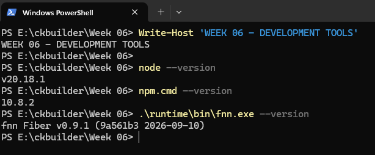
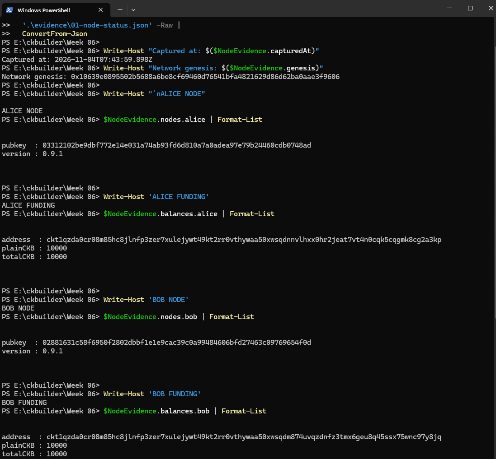
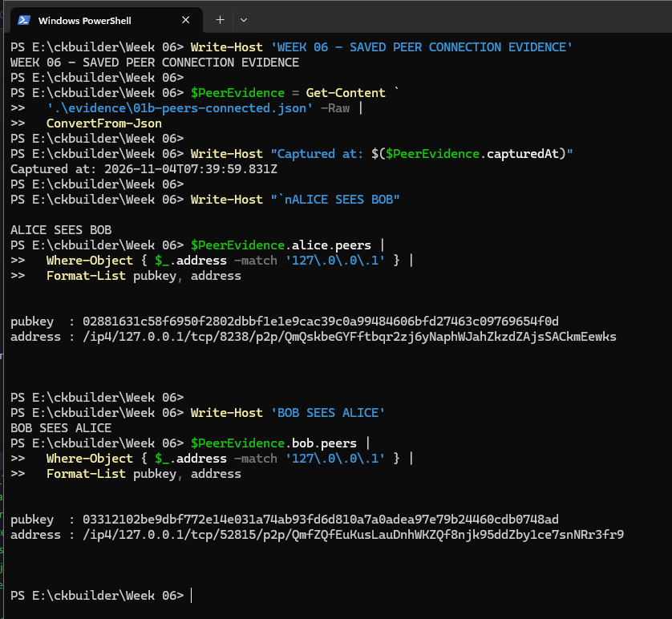
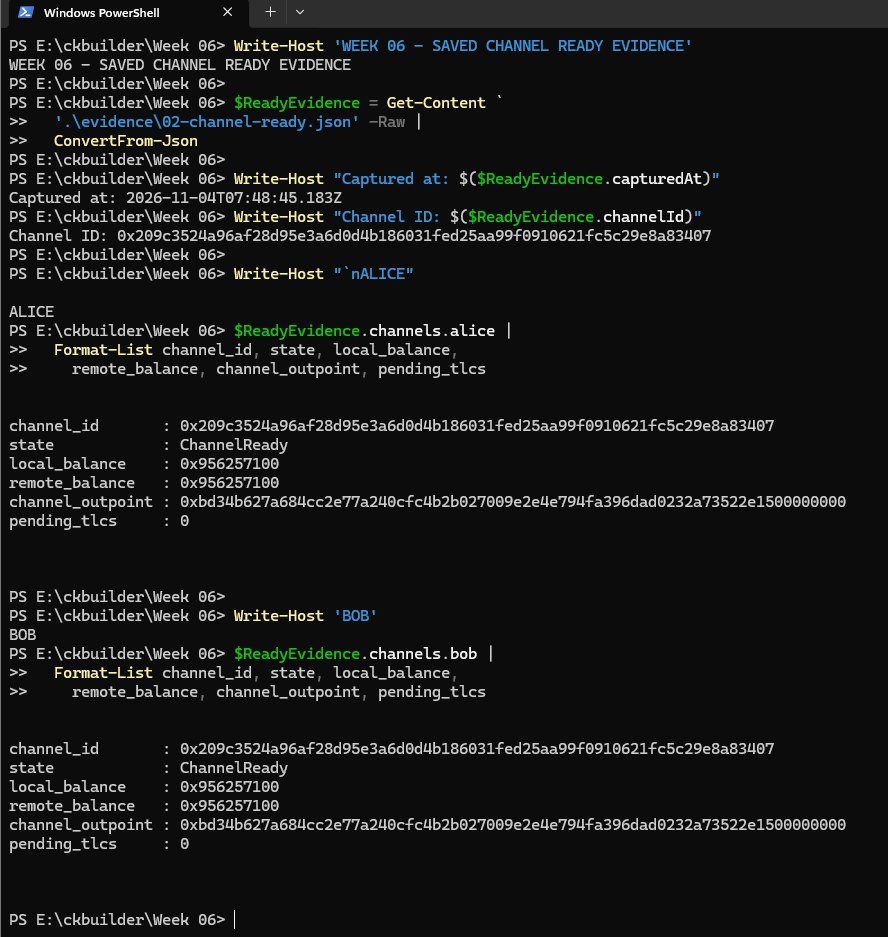
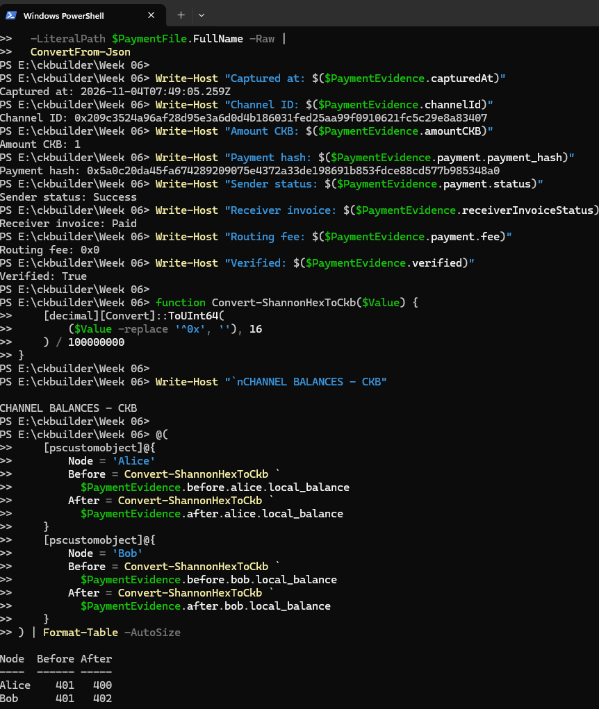
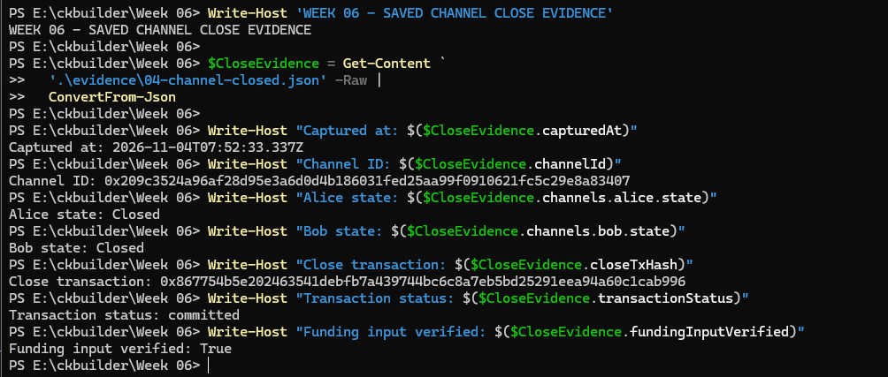
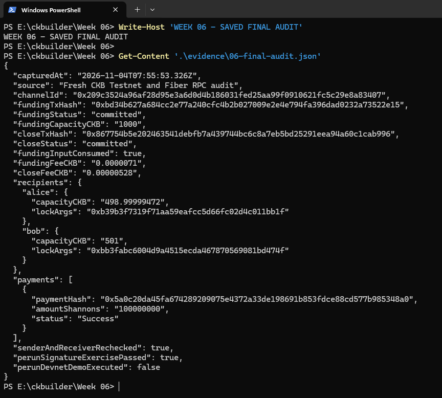
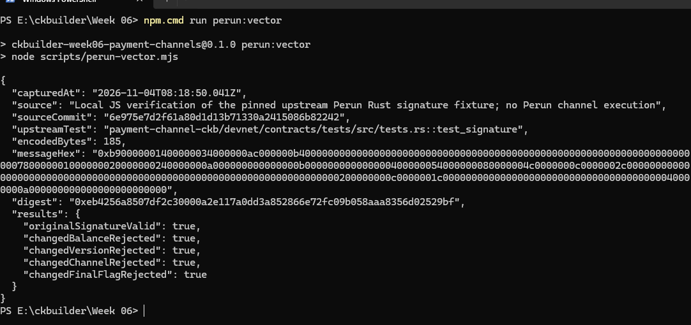
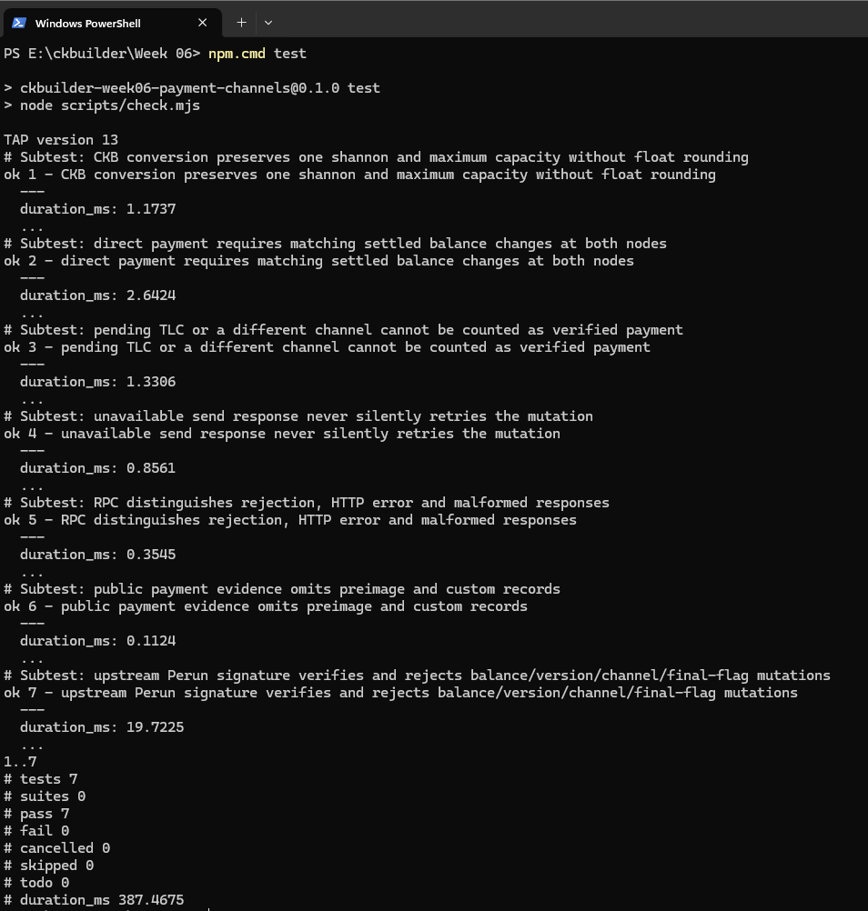

# CKB Weekly Report - Week 6

**Reporting Period:** 04 November 2026  
**Publication Date:** 04 November 2026

---

## 1. Week 6 Overview

The focus of Week 6 was payment channels on Nervos CKB, with practical exercises using **Fiber Network** and an introduction to **Perun channel-state signatures**.

Building on the hash-lock application from Week 5, this work explored how funds locked on-chain can support payments through a channel. The Fiber exercise used two Windows nodes on CKB Testnet and covered connecting peers, opening a channel, sending a payment, and cooperatively closing the channel.

The Perun exercise examined the official CKB example and verified a signed channel-state fixture locally. The full Perun Devnet application was not executed.

**Exercises completed in Week 6:**

- Prepared two Fiber v0.9.1 nodes with separate keys and data directories.
- Funded both Testnet accounts through the faucet.
- Connected Alice and Bob and opened a channel with 500 CKB contributed by each side.
- Sent 1 CKB from Alice to Bob and verified the payment at both nodes.
- Closed the channel cooperatively and verified the committed settlement transaction.
- Checked funding capacity, recipient outputs, and transaction fees through RPC.
- Verified an official Perun signature fixture and rejected modified states.
- Ran seven automated test cases successfully.
- Recorded JSON evidence and nine screenshots.

**Work attribution:** The node setup, scripts, transaction operations, and verification were completed with AI coding assistance. Testnet faucet funding and screenshot collection were performed by the participant.

---

## 2. Exercises Detail

### 2.1. Exercise 01 - Fiber Development Environment and Peer Connection

**Objective:** Prepare two independent Fiber nodes and connect them on CKB Testnet.

**Tools Used:**

- Windows and PowerShell.
- Fiber Network Node v0.9.1.
- Node.js and npm.
- CCC SDK: `@ckb-ccc/core` 1.23.0.
- CKB Testnet and JSON-RPC.

**Procedure and Results:**

1. Downloaded the official Windows release and checked its SHA256 checksum.
2. Prepared separate configurations, keys, and storage for Alice and Bob.
3. Used localhost RPC ports 8227 and 8237, and P2P ports 8228 and 8238.
4. Verified that both nodes used the same CKB Testnet genesis.
5. Received Testnet funds and confirmed the account balances through RPC.
6. Connected Alice to Bob and verified that each node could see the other.

The recorded environment used Node.js 20.18.1. Some resolved dependencies reported an engine requirement of Node >=20.19.0; the project declares that minimum for new installations.

**Result:** Both Fiber nodes were operational and connected.

### 2.2. Exercise 02 - Opening a Payment Channel

**Objective:** Lock Testnet CKB into a channel shared by Alice and Bob.

**Procedure and Results:**

1. Alice proposed a channel with 500 CKB.
2. Bob manually accepted the proposal and contributed another 500 CKB.
3. Recorded the temporary proposal ID and final channel ID.
4. Waited for both nodes to reach `ChannelReady`.
5. Verified the funding transaction and the 1,000 CKB funding output.

| Item | Recorded Result |
|---|---|
| Alice contribution | 500 CKB |
| Bob contribution | 500 CKB |
| Funding Cell capacity | 1,000 CKB |
| Alice initial local balance | 401 CKB |
| Bob initial local balance | 401 CKB |
| Channel state | ChannelReady at both nodes |

The local balances reported by Fiber differed from the contributed amounts because channel capacity reserves must be distinguished from payment balances.

**Channel ID:**

`0x209c3524a96af28d95e3a6d0d4b186031fed25aa99f0910621fc5c29e8a83407`

**Funding transaction hash:**

`0xbd34b627a684cc2e77a240cfc4b2b027009e2e4e794fa396dad0232a73522e15`

**Result:** The channel was funded and ready for payments.

### 2.3. Exercise 03 - Sending and Verifying a Fiber Payment

**Objective:** Send 1 CKB through the channel and verify the resulting balance changes.

**Procedure and Results:**

1. Created a Testnet invoice at Bob's node.
2. Saved its payment hash before submitting the payment from Alice.
3. Queried the sender until its status became `Success`.
4. Queried the receiver invoice and confirmed its status was `Paid`.
5. Compared both channel views after pending TLCs were resolved.

| Node | Local Balance Before | Local Balance After |
|---|---:|---:|
| Alice | 401 CKB | 400 CKB |
| Bob | 401 CKB | 402 CKB |

| Verification | Result |
|---|---|
| Payment amount | 1 CKB |
| Sender status | Success |
| Receiver invoice status | Paid |
| Routing fee | 0 CKB |
| Balance verification | Passed |

**Payment hash:**

`0x5a0c20da45fa674289209075e4372a33de198691b853fdce88cd577b985348a0`

This identifies a Fiber payment, rather than a separate CKB on-chain transaction.

**Result:** The direct payment completed successfully, with matching sender and receiver evidence.

### 2.4. Exercise 04 - Cooperative Channel Closure and On-chain Verification

**Objective:** Close the channel and verify the release of its funding Cell.

**Procedure and Results:**

1. Requested a cooperative shutdown after payment completion.
2. Waited for both nodes to report `Closed`.
3. Confirmed that the closing transaction was `committed`.
4. Verified that it consumed the channel's funding OutPoint.
5. Checked the output lock scripts and capacities for Alice and Bob.
6. Calculated the funding and closing transaction fees from on-chain inputs and outputs.

| Item | Result |
|---|---:|
| Closing output to Alice | 498.99999472 CKB |
| Closing output to Bob | 501 CKB |
| Funding transaction fee | 0.0000071 CKB |
| Closing transaction fee | 0.00000528 CKB |

The closing outputs exclude change outputs from the earlier funding transaction. Additional faucet funding also reached Bob during the exercise, so total wallet balance changes were not used alone to prove the channel payment.

**Closing transaction hash:**

`0x867754b5e202463541debfb7a439744bc6c8a7eb5bd25291eea94a60c1cab996`

**Result:** The channel closed cooperatively, and RPC verification confirmed the funding input and intended recipients. No explorer screenshots are included; the verification evidence comes from RPC.

Both background nodes were stopped after checking automatic backups created after closure. Their keys, databases, and backups remain local.

### 2.5. Exercise 05 - Perun Channel-state Signature Verification

**Objective:** Examine how a signature binds a Perun channel state to its contents.

**Source:** The official Perun CKB example, pinned to commit:

`6e975e7d2f61a80d1d13b71330a2415086b82242`

**Procedure and Results:**

1. Reviewed the example's proposal, allocation update, and settlement code.
2. Extracted the public signature fixture from its Rust `test_signature` test.
3. Reconstructed the 185-byte Molecule-encoded state in JavaScript.
4. Applied the hashing procedure used by the fixture's Rust verifier.
5. Verified the original signature and checked modified states.

| Signature Check | Result |
|---|---|
| Original state | Valid |
| Modified balances | Rejected |
| Modified version | Rejected |
| Modified channel ID | Rejected |
| Modified final flag | Rejected |

**Result:** The fixture verified successfully, and all four state modifications invalidated the original signature.

**Scope:** This was local verification of an official signed-state fixture. It did not execute Perun Rust contract tests, create a live Perun channel, or test dispute resolution. The full Devnet demo remains pending because the required Go and Linux environment was not available.

### 2.6. Exercise 06 - Automated Testing and Recovery Handling

**Objective:** Verify utility behavior and avoid treating uncertain RPC responses as successful operations.

**Test Results:**

| Test Case | Result |
|---|---|
| CKB amount conversion and integer limits | Passed |
| Matching payment balance changes at both nodes | Passed |
| Pending TLC and mismatched channel rejection | Passed |
| No automatic resend after an unavailable write response | Passed |
| RPC rejection, HTTP failure, and malformed-response handling | Passed |
| Public payment evidence excludes preimages and custom records | Passed |
| Perun signature fixture and modified-state checks | Passed |

**Result:** All seven automated test cases passed.

During the integration exercise, a channel accepted by Bob was not immediately visible in Alice's query. The polling logic was adjusted to wait for propagation. Funding and closing confirmations were rechecked using the saved operation state, without reopening the channel or resending a payment.

---

## 3. Summary and Key Learnings

The exercises demonstrated several distinctions relevant to CKB payment-channel development:

- **On-chain and off-chain activity:** Funding and settlement are CKB transactions; a Fiber payment is tracked through its payment hash and invoice.
- **Capacity and liquidity:** Contributed channel capacity, local payment balance, and wallet balance represent different quantities.
- **Verification:** A submitted RPC call is not sufficient evidence of completion. Channel state, payment status, receiver invoice, and on-chain outputs need separate checks.
- **Recovery:** Persisting identifiers makes it possible to recheck uncertain operations without immediately submitting another transaction.
- **Signed states:** The Perun fixture binds balances, version, channel ID, and the final flag to the signature.
- **Testing limits:** Passing a signature fixture does not establish that a complete Perun channel or dispute workflow has been tested.

---

## 4. Plan for Week 7

1. Prepare a compatible Linux and Go environment for the full Perun CKB example.
2. Build and run the Perun contract tests before attempting the Devnet application.
3. Observe channel allocation updates and settlement in the official demo.
4. Study channel reserves, liquidity direction, and cooperative versus forced closure.
5. Explore Fiber multi-hop payments after reproducing the direct-channel workflow.
6. Extend the development log with observations from these further exercises.

---

## 5. References

- [Nervos CKB Documentation](https://docs.nervos.org/).
- [Fiber Native Node Guide](https://www.fiber.world/docs/quick-start/run-a-node/rust).
- [Fiber Basic Transfer Guide](https://www.fiber.world/docs/quick-start/basic-transfer).
- [Fiber v0.9.1 RPC Reference](https://github.com/nervosnetwork/fiber/blob/v0.9.1/crates/fiber-lib/src/rpc/README.md).
- [Pinned Perun CKB Example](https://github.com/perun-network/perun-examples/tree/6e975e7d2f61a80d1d13b71330a2415086b82242/payment-channel-ckb).
- [Perun CKB Backend](https://github.com/perun-network/perun-ckb-backend).
- [CCC SDK](https://github.com/ckb-devrel/ccc).

---

## 6. Evidence

The channel and payment screenshots below present saved RPC results from the completed exercise on 04 November 2026. The channel is now closed. The Perun and automated-test evidence comes from local execution.

### 6.1. Development Tools

### 6.2. Nodes and Faucet Balances

### 6.3. Peer Connection

### 6.4. Channel Ready

### 6.5. Payment and Balance Verification

### 6.6. Channel Closed

### 6.7. Final RPC Audit

### 6.8. Perun Signature Verification

### 6.9. Automated Tests

**Machine-readable evidence:**

- [Node and funding snapshot](evidence/01-node-status.json).
- [Peer connections](evidence/01b-peers-connected.json).
- [ChannelReady snapshot](evidence/02-channel-ready.json).
- [Payment verification](evidence/payment-0x5a0c20da45fa674289209075e4372a33de198691b853fdce88cd577b985348a0.json).
- [Channel closure](evidence/04-channel-closed.json).
- [Perun signature exercise](evidence/05-perun-signature-vector.json).
- [Final audit](evidence/06-final-audit.json).
- [Automated tests](evidence/07-automated-tests.json).
- [Runtime cleanup](evidence/08-runtime-status.json).

---

## 7. Project and Reproduction Guides

- [Project overview and environment notes](PROJECT_GUIDE.md).
- [Fiber walkthrough](RUN_FIBER.md).
- [Perun walkthrough and pending prerequisites](RUN_PERUN.md).
- [Concept notes](LEARNING.md).
- [GitHub submission commands](PUSH_GITHUB.md).
