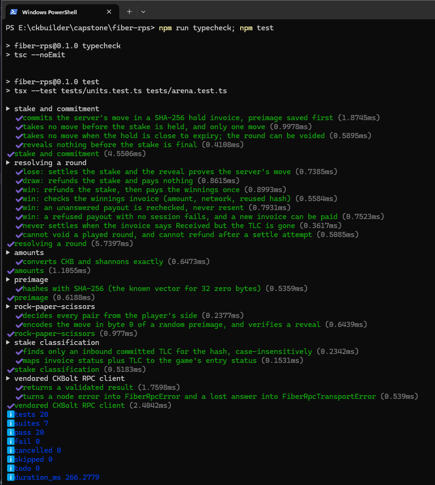
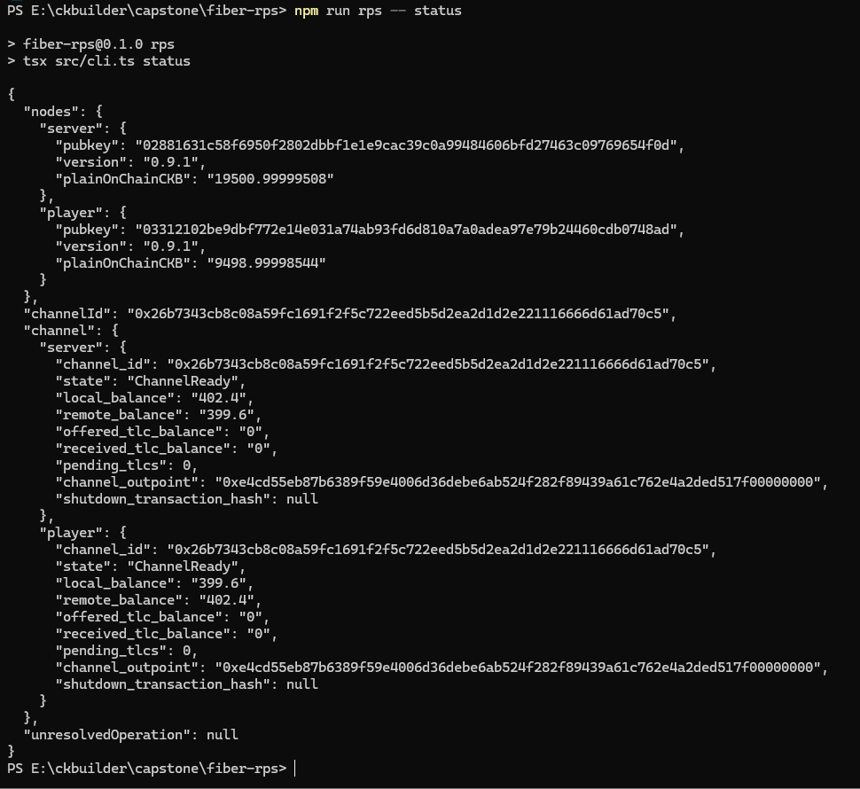
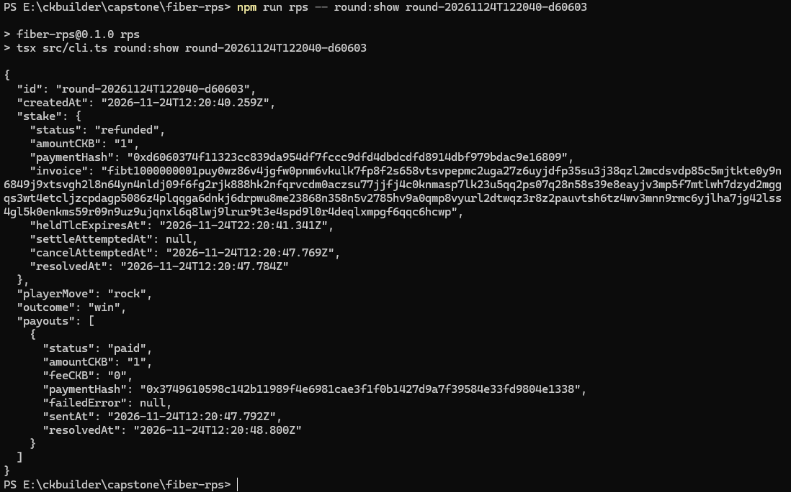
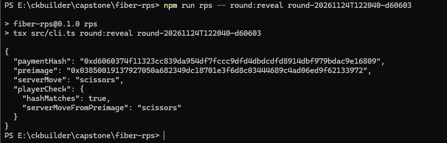
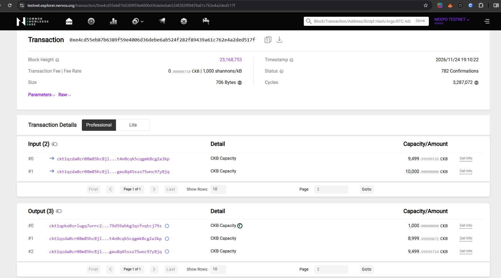

# CKB Weekly Report - Week 9

**Reporting Period:** 24 November 2026
**Publication Date:** 24 November 2026

---

## 1. Week 9 Overview

Week 9 starts the final course project, **Fiber RPS**: rock-paper-scissors against a game server, with the stake and
winnings paid over the Fiber Network on CKB Testnet. The server commits to its move inside a Fiber hold invoice before
the player chooses, so it cannot change its move afterwards.

This week built the game's payment and fairness core and played it on CKB Testnet with two Fiber nodes. The web
interface is planned for Week 10.

**Completed in Week 9:**

- Set up the project in [`capstone/fiber-rps`](../capstone/fiber-rps/).
- Reused CKBolt's Fiber JSON-RPC client, with attribution and its license.
- Implemented the round:
  - the server commits its move in the hold invoice's preimage;
  - the player's stake is held while the round is played;
  - the round ends with a settle on a loss, a refund on a draw, or a refund plus winnings on a win;
  - the preimage is revealed so the player can check the server's move.
- Wrote 20 unit tests against an in-memory Fiber node; all pass.
- Opened a 500 + 500 CKB channel on Testnet.
- Played four rounds on Testnet that produced a loss, a draw and a win.
- Verified the final channel balances against the expected amounts.

**Work attribution:** The design, code, tests and Testnet operations were completed with AI coding assistance. Part of
the code is reused from CKBolt, as described in section 3.

---

## 2. Why Rock-Paper-Scissors on Fiber

A two-player game in which one side moves second is only fair if the first move is fixed and kept hidden. A Fiber hold
invoice provides this:

- **Commitment:** the invoice's payment hash is `sha256(preimage)`, and the server's move is byte 0 of the preimage. The
  player sees the hash before choosing. The other 31 random bytes hide the move.
- **Escrow:** the player's stake is held in the channel. The server can take it only by settling, which reveals the
  preimage and with it the move. If the server never acts, the held payment returns to the player when it expires.
- **Instant, off-chain:** stakes, refunds and winnings are channel updates, with no on-chain transaction per round.

The game uses only Testnet CKB, which has no real value.

---

## 3. Reused Code: CKBolt

[CKBolt](https://github.com/Tech-Expansion/CKBolt) is a swap hub between Bitcoin Lightning and CKB Fiber. Only its Fiber
RPC layer was reused, from commit `e2bba3c`:

| Reused | Changed |
|---|---|
| JSON-RPC client, protocol framing, response schemas (zod), constants, error types | Import paths; added `connect_peer`, `accept_channel`, close parameters and channel fields; error classes no longer depend on NestJS |

The license is the Business Source License 1.1, which allows use on test networks only. Its text is kept in
`src/vendor/ckbolt/LICENSE`, and `NOTICE.md` lists every change. The game rules, commitment scheme, demo player,
channel handling, CLI and tests were written for this project.

CKBolt's research notes also documented fnn v0.9.1 behaviour that the official RPC reference does not describe. The
design relies on three of these points:

- hold invoices must use `hash_algorithm: "sha256"`;
- `cancel_invoice` also works after the payment is held, as long as no preimage was stored;
- an invoice can still read `Received` after its held payment has timed out, so the server must check the held TLC
  itself before settling.

---

## 4. Implementation

### 4.1. A Round

1. The server picks a random move and builds the preimage: one byte for the move, then 31 random bytes. It saves the
   preimage locally, then creates a hold invoice for the 1 CKB stake with only the SHA-256 hash.
2. The player pays. The payment stops at the server as a held TLC (`Inbound: Committed`); on the player's side it
   stays `Inflight`.
3. The player sends one move. The server accepts it only while the stake is held with enough time left, and only once.
4. The server resolves the round:
   - **Loss:** `settle_invoice` with the preimage. The server keeps the stake.
   - **Draw:** `cancel_invoice`. The player's payment fails with `InvoiceCancelled`, which returns the stake.
   - **Win:** `cancel_invoice`, then `send_payment` of 1 CKB to the player's invoice.
5. The server reveals the preimage. The player checks the hash and reads the server's move.

### 4.2. Safety Rules

- **Before settling:** the server checks that the held TLC is really in the channel, not only that the invoice status is
  `Received`.
- **After a settle attempt:** a refund is refused, and a round that was played cannot be voided.
- **Winnings:**
  - they are recorded before they are sent and paid at most once per round;
  - the invoice must be exactly 1 CKB, on Testnet, with a payment hash not used before;
  - an unanswered send is only re-read with `get_payment`, never sent again automatically.

### 4.3. Tests

`npm test` runs 20 tests, all passing on 24 November 2026. They cover:

- all nine move pairs;
- the move encoding and reveal check;
- stake-state classification;
- the move rules: none before payment, only one, none near expiry;
- loss, draw and win resolution;
- winnings invoice checks, a lost answer, a refused send and a missing TLC;
- the reused RPC client's error handling.

---

## 5. Testnet Results

Two Fiber v0.9.1 nodes ran on CKB Testnet (genesis `0x10639e08...f9606`): the game server (the Week 6 Bob node) and the
demo player (the Week 6 Alice node). The demo player chose its moves at random.

### 5.1. Channel

| Item | Result |
|---|---|
| Channel ID | `0x26b7343cb8c08a59fc1691f2f5c722eed5b5d2ea2d1d2e221116666d61ad70c5` |
| Funding transaction | `0xe4cd55eb87b6389f59e4006d36debe6ab524f282f89439a61c762e4a2ded517f` |
| Funding | 500 CKB from each side, private channel |
| Usable balance at open | 401 CKB on each side |

Before the rock-paper-scissors rounds, an earlier quiz prototype of this project made test payments on the same
channel. These moved the balances to 401.4 CKB (server) and 400.6 CKB (player). The rounds below start from those
balances.

### 5.2. Rounds

| Round | Player | Server (revealed) | Result | Stake (payment hash) | Money |
|---|---|---|---|---|---|
| 1 | paper | scissors | lose | `0x9b678c0c...c41fd9` | Settled: server keeps 1 CKB |
| 2 | paper | scissors | lose | `0x94bb3325...a63265` | Settled: server keeps 1 CKB |
| 3 | rock | rock | draw | `0xaf2e396f...566cac` | Cancelled: player payment `Failed: InvoiceCancelled`, stake returned |
| 4 | rock | scissors | win | `0xd6060374...e16809` | Cancelled, then 1 CKB winnings paid (`0x37496105...4e1338`, fee 0) |

For every round, the revealed preimage hashes to the stake invoice's payment hash, and its first byte gives the server
move shown. In round 1 the held stake's TLC expired 10 hours after payment, so the round had ample time.

### 5.3. Balance Check

| Side | Before the rounds | After | Expected |
|---|---|---|---|
| Server | 401.4 CKB | 402.4 CKB | +1 +1 (two losses) +0 (draw) -1 (winnings) |
| Player | 400.6 CKB | 399.6 CKB | the opposite |

No TLC was left pending after the rounds. The channel stays open for the next weeks. The only on-chain transaction this
week was the channel funding.

---

## 6. Evidence

| File | Content |
|---|---|
| [01-status-before.json](evidence/01-status-before.json) | Nodes, versions and on-chain balances before the channel |
| [02-channel-open.json](evidence/02-channel-open.json) | Channel ready on both sides, funding transaction |
| [03-status-before-rps.json](evidence/03-status-before-rps.json) | Channel balances before the rounds |
| [04-round1-stake-held.json](evidence/04-round1-stake-held.json) | Round 1 stake held: TLC on both sides, player payment `Inflight` |
| `04`-`07` `-resolved.json` | Each round's move, outcome, stake status and the player's view of the payments |
| `04`-`07` `-reveal.json` | Each round's revealed preimage, with the player-side hash check |
| [06-round3-player-refund-confirmed.json](evidence/06-round3-player-refund-confirmed.json) | Draw: player payment `Failed: InvoiceCancelled` |
| [08-status-after-rps.json](evidence/08-status-after-rps.json) | Channel balances after the rounds |

The JSON files record live RPC answers from 24 November 2026. A preimage is published only after its round is decided,
by design. The state file with any unrevealed preimage is kept in the git-ignored `runtime/` folder.

### Screenshots

| Screenshot | Shows |
|---|---|
| [01-unit-tests.png](evidence/screenshots/01-unit-tests.png) | Typecheck with no errors; 20 tests, 20 pass, 0 fail |
| [02-channel-status.png](evidence/screenshots/02-channel-status.png) | Both nodes on fnn 0.9.1; channel `ChannelReady` with 402.4 / 399.6 CKB and no pending TLC |
| [03-round1-lose.png](evidence/screenshots/03-round1-lose.png) | Round 1: player `paper`, outcome `lose`, stake `settled` |
| [04-round3-draw.png](evidence/screenshots/04-round3-draw.png) | Round 3: player `rock`, outcome `draw`, stake `refunded` |
| [05-round4-win.png](evidence/screenshots/05-round4-win.png) | Round 4: player `rock`, outcome `win`, stake `refunded`, 1 CKB winnings `paid` with fee 0 |
| [06-round4-reveal.png](evidence/screenshots/06-round4-reveal.png) | Round 4 reveal: the hash matches and the preimage gives the server move `scissors` |
| [07-funding-tx-explorer.png](evidence/screenshots/07-funding-tx-explorer.png) | Channel funding transaction on the CKB Testnet explorer: block 23,168,753, 1,000 CKB funding output |

---

## 7. Not Yet Done and Next Steps

Not covered in this report:

- Academy item 7 and the interactive tutorial.
- Neon's confirmation of the project scope.

Planned for Week 10:

- A local game API and a React interface: stake invoice with QR code, payment status, move buttons, result, and the
  reveal check in the browser.
- Handling of errors such as an unpaid stake, a player who never moves, a node going offline, too little channel
  balance for winnings, and a server restart in the middle of a round.
